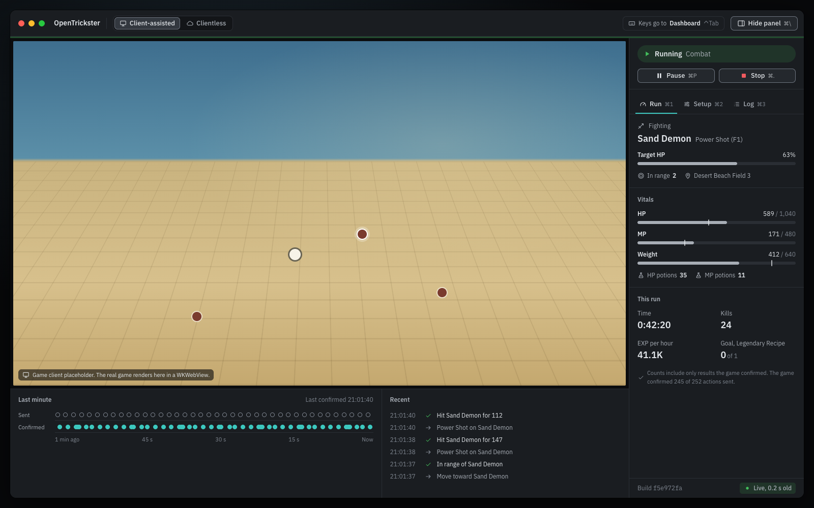
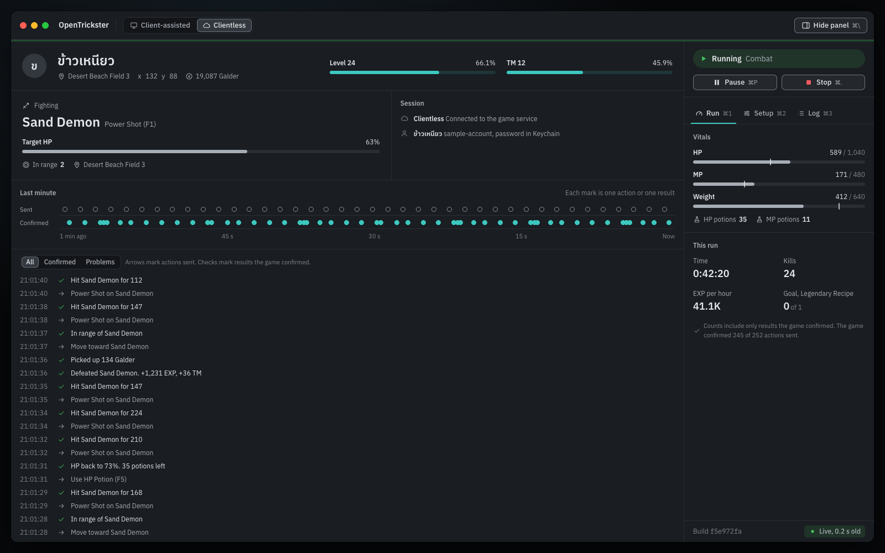
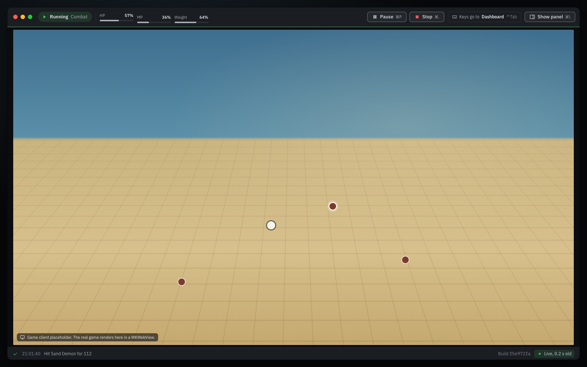
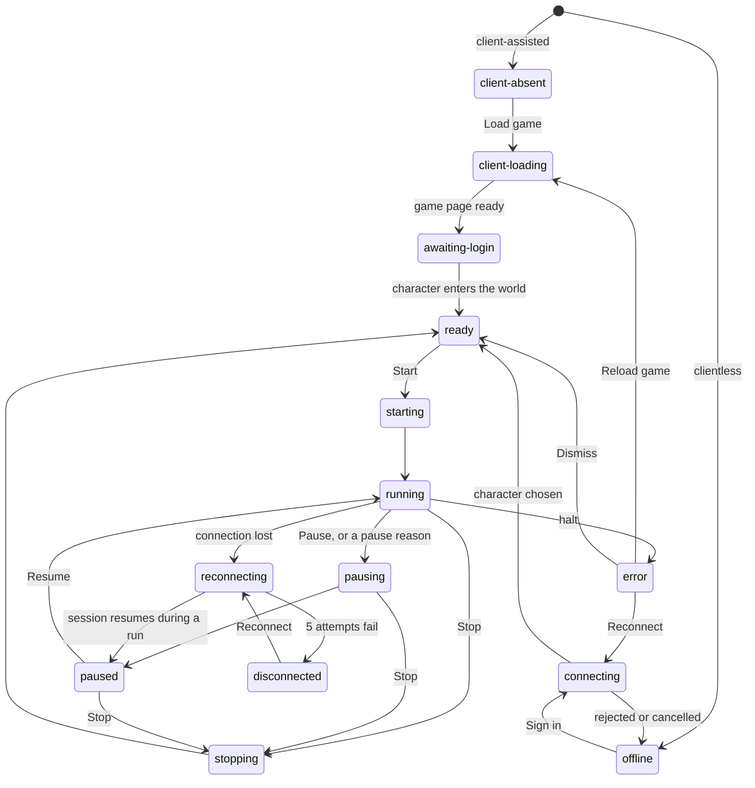
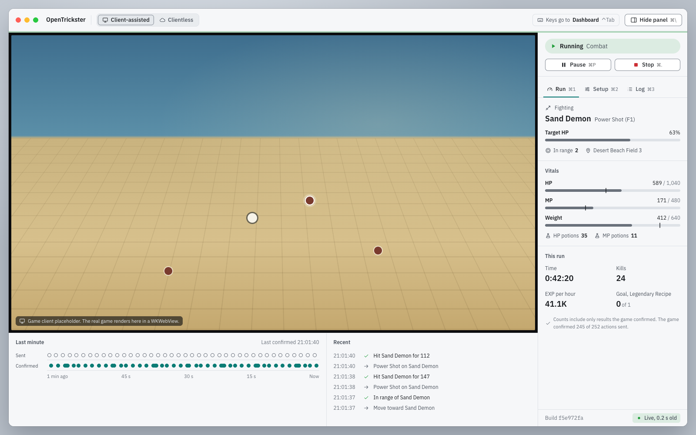
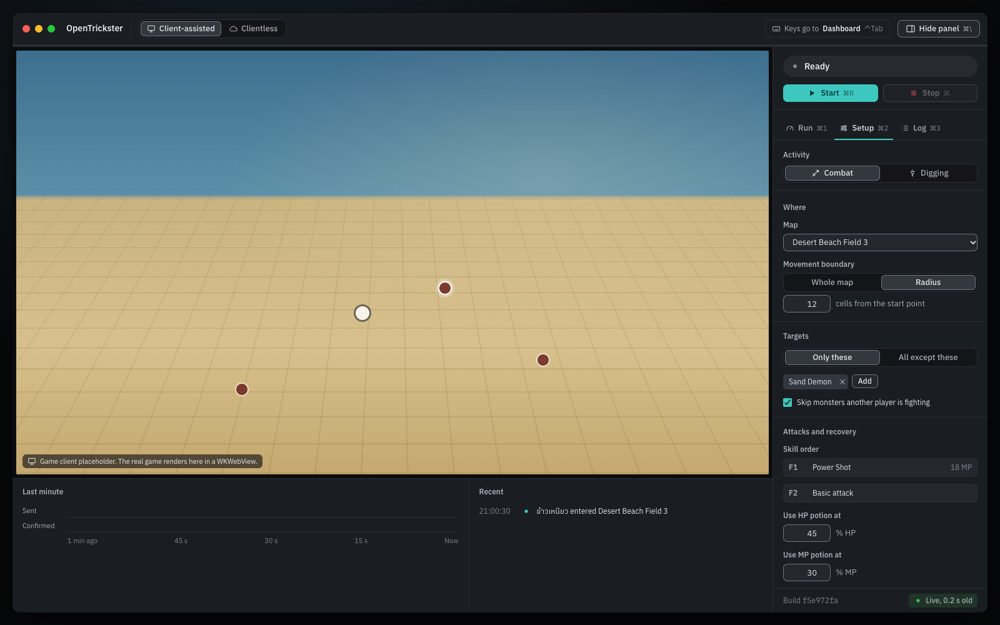

# Design

This file is the design reference for the OpenTrickster macOS app. The [Decisions](#decisions) table lists what the owner confirmed on 2026-11-08 in [issue #9](https://github.com/oDestroyeRo/opentrickster/issues/9), and which values are defaults or derived. The rest of the file specifies the layout, states, controls, visual tokens, and components as the prototype built them to carry out those decisions. The owner did not confirm each specification separately. Read this file before you build or change any part of the app's UI.

The decisions come from an interactive HTML prototype on the throwaway [`research/macos-app-ui-prototype`](https://github.com/oDestroyeRo/opentrickster/tree/e4af28319a522bf92f1456166e6e11750e42af95/prototypes/macos-app-ui) branch. The prototype is not production code and never merges into `main`. Every name, map, monster, item, and number in the screenshots is sample data. Sizes are logical pixels.

## Decisions

| Area | Decision | Status |
| --- | --- | --- |
| Layout | The game on the left and a 344 px side panel on the right. **Hide panel** (⌘\\) hides the panel and gives the game the window. The prototype calls this layout A. | Confirmed |
| Theme | Follows the macOS appearance setting | Confirmed |
| Palette | Graphite neutrals with one lagoon accent | Confirmed |
| Typeface | IBM Plex Sans with IBM Plex Sans Thai | Confirmed |
| Shortcuts | The [keyboard table](#keyboard-and-menus) | Confirmed |
| Policies | The [seven policies](#policies) | Confirmed |
| Alerts | Notify on a pause with a reason, a lost connection, and a reached goal, and badge the Dock icon. All four are on by default. | Confirmed |
| UI language | English for the app's own text. Game data, such as Thai character, map, and item names, appears as the game supplies it. | Default. The owner can still choose Thai or both. |
| Minimum window | 972 × 641 | Derived from the proposed 960 × 540 minimum game size, which #11 owns |

## Constraints from research

The design takes these constraints from the [implementation evidence](docs/research/README.md).
Its prototypes remain illustrative; implementation and runtime proof are tracked separately.

- The game runs in a native `WKWebView` child inside one GPUI window, in a reserved rectangle. A separate browser window does not meet the product requirement. The [GPUI embedding report from #4](https://github.com/oDestroyeRo/opentrickster/blob/89d5993882982e959fc078f6690c8562abd7cb44/docs/research/macos-gpui-embedding.md) supplied the initial inference. Account-free hosting/title checks have since run, as recorded in [architecture](docs/architecture.md#host-evidence) and [desktop work #22](https://github.com/oDestroyeRo/opentrickster/issues/22). Live gameplay and nonzero-socket cleanup remain integration checks.
- The native child sits outside GPUI clipping and paint order. No GPUI-drawn tooltip, banner, message, popover, or focus ring may cover the game rectangle. Whether macOS menus, sheets, and tooltips draw over the webview is unverified, and #11 owns that test.
- The game page sizes its own canvas. Its desktop default is 1280 × 720 CSS pixels, scaled to fit the rectangle it gets (#4). The app keeps the game rectangle at 16:9.
- The webview receives keyboard input while it has focus. Command shortcuts and Escape need joint verification with GPUI (#4).
- Nobody knows yet whether the game is readable at a given minimum size (#4). The design proposes 960 × 540.
- The implementation profile is pinned to build `8502ebbf2fc9033d2fba50d02fd92002` and the fingerprints in [current-build revalidation](docs/research/current-build-protocol-revalidation.md). Earlier build `f5e972fa` and invented prototype label `7c21e0b4` are not compatibility checks.
- A [production Rust startup test](docs/research/native-rust-startup.md) completed one sign-in, existing-character selection, initial-state receipt, and joined cleanup without Unity. Inventory readiness, recovery, and gameplay remain under [MVP delivery #19](https://github.com/oDestroyeRo/opentrickster/issues/19). The earlier [standalone probe](docs/research/native-startup-current-build.md) tested a separate implementation.

The screenshots and prototype messages remain sample data. Production defaults
and shared contracts are specified in [MVP behavior](docs/mvp.md) and
[architecture](docs/architecture.md); their live adapter acceptance remains open.

## Window

### Panel shown



The window has a 52 px unified toolbar, a 3 px pulse strip under the toolbar, and a body.

- The toolbar holds the traffic lights, the app name, the mode switch, the keyboard badge in client-assisted mode, and the panel toggle.
- In client-assisted mode, the game pane fills the left side of the body. A strip under the game shows the last minute of activity and the six newest log rows. The strip takes the height that the 16:9 game leaves, and at least 150 px.
- The side panel on the right is 344 px wide. From top to bottom, it holds the large status pill, the run controls, the blocked reason or a refused-action message, the alert banner, the Run, Setup, and Log tabs, and a footer with the status line.
- In clientless mode, the clientless board replaces the game pane and the strip. The side panel does not change.



### Panel hidden



**Hide panel** or ⌘\\ hides the side panel and the strip. **Show panel**, ⌘\\, or any of ⌘1 to ⌘3 shows them again.

- The toolbar holds the traffic lights, the status pill, the HP, MP, and weight mini meters once a character is in the world, the labeled run controls, the keyboard badge in client-assisted mode, and the panel toggle. The app name and the mode switch leave the toolbar. To switch modes, show the panel.
- The game fills the window between the toolbar and a 34 px ticker. The ticker shows the latest confirmed result, the blocked reason, the current alert, or a refused-action message.
- In clientless mode, the board adds the vitals and the run totals.

### Sizes

The prototype measured these sizes in headless Chrome. Each window size includes the toolbar.

| View | Game in a 1560 × 960 window | Game in a 1252 × 772 window | Smallest window for a 960 × 540 game |
| --- | --- | --- | --- |
| Panel shown | 1204 × 677 | 896 × 504 | 1316 × 757 |
| Panel hidden | 1527 × 859 | 1193 × 671 | 972 × 641 |

- The window's minimum size is 972 × 641, the smallest window that keeps a 960 × 540 game with the panel hidden. With the panel shown, a window narrower than 1316 px shrinks the game below 960 × 540. If #11 changes the minimum game size, these sizes change with it, and the prototype's `measure.mjs` measures them again.
- With the panel hidden, the toolbar needs 1231 px in its widest state, "Paused, Check after reconnect". Below a 1232 px window, the mini meters hide. If the toolbar still runs out of room, the status pill's detail ends in an ellipsis.
- On a clientless board narrower than 900 px, the character header moves the Level and TM meters to a second row.

## Session states

One reducer drives every screen. In the prototype, `reduceSession` in `index.html` applies events through the transition table `T` and touches no rendering code. In the `error` phase, `canSession` also reads each halt's recovery actions from the `HALTS` table, so the #8 contract work would lift those actions with the reducer. The diagram shows the main transitions. The table `T` has the rest.



| Phase | Status pill | What the user can do |
| --- | --- | --- |
| `client-absent` | Game not loaded | Load the game from the game pane. |
| `client-loading` | Loading game, with a percentage | Wait. |
| `awaiting-login` | Log in to the game | Log in inside the game. The app never sees the password. |
| `offline` | Not connected | Sign in on the connect panel. A rejected sign-in shows its alert inside the form. |
| `connecting` | Connecting, with the current step | Choose a world and a character, or cancel. |
| `ready` | Ready | Start (⌘R) once the preflight checks pass. |
| `starting` | Starting | Stop (⌘.). |
| `running` | Running, with the activity | Pause (⌘P) or Stop (⌘.). |
| `pausing` | Pausing, Finishing this action | Stop (⌘.). The current action finishes first. |
| `paused` | Paused, with the reason | Resume (⌘R) once nothing blocks it, or Stop (⌘.). |
| `stopping` | Stopping, Finishing this action | Wait. The current action finishes first. |
| `reconnecting` | Reconnecting, attempt N of 5 | End the run (⌘.). |
| `disconnected` | Disconnected | Reconnect, or end the run (⌘.). |
| `error` | The halt's short name | The halt's recovery action. |

Every pause has a reason, and the alert names what unlocks Resume.


| Reason | Status detail | What lets the run resume |
| --- | --- | --- |
| `user` | By you | Resume. |
| `hp-potions` | Out of HP potions | Restock in the game. Resume stays locked while the bag has no HP potions. When the session cannot use HP potions, as in client-assisted mode, the run pauses at the HP potion threshold instead, and the alert says to recover HP in the game. |
| `weight` | Bag weight limit | Free space in the game. |
| `drill` | Drill durability | Repair or replace the drill in the game. |
| `depth` | Drill too shallow | Equip a deeper drill or choose another area. |
| `goal` | Goal reached | Turn in the quest in the game, then resume or stop. |
| `fainted` | Character fainted | Revive in the game. |
| `no-drops` | No drops | Check the loot list and the map. |
| `uncertain` | State uncertain | Resume when the state is live again. |
| `reconnected` | Check after reconnect | Check the character, then resume. |

A halt stops the run. Some halts also stop the app from reading game state, and the status line then says "No live state".

| Halt | Status pill | Recovery | Game state still read |
| --- | --- | --- | --- |
| `build-changed` | Game updated | Reload game, or Reconnect in clientless mode | No |
| `client-failed` | Game client stopped | Reload game, shown in the game pane | No |
| `session-replaced` | Signed in elsewhere | Log in again, or Reconnect in clientless mode | No |
| `actions-rejected` | Actions rejected | Dismiss | Yes |
| `map-forbidden` | Map blocks automation | Dismiss | Yes |

## Policies

These rules shape several screens.

1. After a reconnect, a run comes back paused for a check. The bot resends nothing on its own.
2. Setup locks while the run is starting or running. While the run is paused, setup is editable, and the changes apply on resume. The activity choice stays locked until the run ends.
3. The mode switch works only when no run exists, including a run held during a disconnect. Once a game or a session is open, a system sheet asks before the app switches.
4. The bot never buys items, revives the character, or accepts or turns in quests.
5. Three rejected actions in a row stop the run instead of retrying.
6. When no state update arrives for 15 seconds, the run pauses.
7. Run counts include only results that the game confirmed. The run totals show how many sent actions the game confirmed.

## Alerts

The Alerts section of the setup form has four checkboxes. All four are on by default.

- Notify me when a run pauses for a reason
- Notify me when the connection drops
- Notify me when a goal is reached
- Show a badge on the Dock icon

## Keyboard and menus

| Shortcut | Action |
| --- | --- |
| ⌘R | Start, or Resume when paused |
| ⌘P | Pause |
| ⌘. | Stop, or End run while reconnecting or disconnected |
| ⌘1, ⌘2, ⌘3 | Show the Run, Setup, or Log tab. A hidden panel shows again. |
| ⌃Tab | Move keyboard focus between the game and the dashboard |
| ⌘\\ | Hide or show the side panel |
| Escape | Close the system sheet |

⌘R and ⌘. match Run and Stop in Xcode. ⌘P takes over Print, which the app does not need. In client-assisted mode, the keyboard badge says whether keys go to the game or to the dashboard. While the game owns the keyboard, a focus ring surrounds the game rectangle.

The menu bar has a Run menu with **Start** or **Resume** (⌘R), **Pause** (⌘P), and **Stop** or **End run** (⌘.). Its View menu has the three tabs (⌘1 to ⌘3) and **Hide Panel** or **Show Panel** (⌘\\). Menu key equivalents are the candidate way to keep these shortcuts working while the webview has keyboard focus, and #11 must verify that. In GPUI, `App::set_menus` installs the menus, and `MenuItem::action` ties each item to the same action that the buttons dispatch.

## Visual system



- The theme follows the macOS appearance setting and changes when the setting changes. The dark and light themes take their own steps from the same primitives. The game letterbox stays near black in both themes.
- Colors use graphite neutrals and one lagoon accent.
- Four status colors are reserved for good, warning, serious, and critical. No status relies on color alone. Each one has an icon and a label, and the pulse strip under the toolbar uses its own pattern for each state.
- The UI type is IBM Plex Sans with IBM Plex Sans Thai, so Thai character names and Latin labels share one design. IBM Plex Mono appears only in build identifiers and coordinates.
- Every line height is at least 1.5 times its font size, because Thai stacks vowels and tone marks above and below the baseline. Measured in Chrome with IBM Plex Sans Thai, the cluster ปู่ needs 1.46 times its size to fit inside a line box that centers it.

### Tokens

The prototype's `build-tokens.mjs` generates the tables in this section from its [`tokens.json`](https://github.com/oDestroyeRo/opentrickster/blob/e4af28319a522bf92f1456166e6e11750e42af95/prototypes/macos-app-ui/tokens.json). Do not edit the tables by hand. The script exits with code 1 when a contrast pair falls below its WCAG minimum or a type size has a line height under 1.5 times the size. It refreshes this file when the file sits at the repository root next to `prototypes/`. To regenerate the tables, run these commands in a clean checkout, then carry the refreshed `DESIGN.md` back to `main`.

```sh
git switch research/macos-app-ui-prototype
git checkout main -- DESIGN.md
node prototypes/macos-app-ui/build-tokens.mjs
```

The GPUI columns give the literal to pass to `gpui::rgb` or `gpui::rgba`.

<!-- tokens:start -->

#### Semantic colors

| Token | dark hex | dark GPUI | light hex | light GPUI |
| --- | --- | --- | --- | --- |
| `surface.base` | `#131518` | `rgb(0x131518)` | `#E9ECEF` | `rgb(0xE9ECEF)` |
| `surface.panel` | `#1A1D21` | `rgb(0x1A1D21)` | `#F6F7F9` | `rgb(0xF6F7F9)` |
| `surface.raised` | `#24282D` | `rgb(0x24282D)` | `#FFFFFF` | `rgb(0xFFFFFF)` |
| `surface.hover` | `#2C3036` | `rgb(0x2C3036)` | `#EEF0F3` | `rgb(0xEEF0F3)` |
| `surface.selected` | `#33383F` | `rgb(0x33383F)` | `#E3E7EB` | `rgb(0xE3E7EB)` |
| `surface.letterbox` | `#0B0C0E` | `rgb(0x0B0C0E)` | `#0B0C0E` | `rgb(0x0B0C0E)` |
| `line.subtle` | `#2A2E34` | `rgb(0x2A2E34)` | `#DEE2E7` | `rgb(0xDEE2E7)` |
| `line.control` | `#6E7580` | `rgb(0x6E7580)` | `#858C96` | `rgb(0x858C96)` |
| `text.primary` | `#E3E7EB` | `rgb(0xE3E7EB)` | `#1A1D21` | `rgb(0x1A1D21)` |
| `text.secondary` | `#A7ADB5` | `rgb(0xA7ADB5)` | `#4B525C` | `rgb(0x4B525C)` |
| `text.muted` | `#7F8690` | `rgb(0x7F8690)` | `#6A717B` | `rgb(0x6A717B)` |
| `text.on-accent` | `#062E2C` | `rgb(0x062E2C)` | `#FFFFFF` | `rgb(0xFFFFFF)` |
| `accent.default` | `#3CC8BF` | `rgb(0x3CC8BF)` | `#0B7C75` | `rgb(0x0B7C75)` |
| `accent.hover` | `#6FDCD3` | `rgb(0x6FDCD3)` | `#0A615C` | `rgb(0x0A615C)` |
| `accent.subtle` | `#3CC8BF26` | `rgba(0x3CC8BF26)` | `#1FAEA522` | `rgba(0x1FAEA522)` |
| `status.neutral` | `#7F8690` | `rgb(0x7F8690)` | `#6A717B` | `rgb(0x6A717B)` |
| `status.good` | `#43BF5C` | `rgb(0x43BF5C)` | `#1F9D3A` | `rgb(0x1F9D3A)` |
| `status.warning` | `#E9B341` | `rgb(0xE9B341)` | `#B07800` | `rgb(0xB07800)` |
| `status.serious` | `#EE8A55` | `rgb(0xEE8A55)` | `#C9561A` | `rgb(0xC9561A)` |
| `status.critical` | `#EF5A5F` | `rgb(0xEF5A5F)` | `#CC2F35` | `rgb(0xCC2F35)` |
| `status.good.subtle` | `#43BF5C24` | `rgba(0x43BF5C24)` | `#1F9D3A1F` | `rgba(0x1F9D3A1F)` |
| `status.warning.subtle` | `#E9B34124` | `rgba(0xE9B34124)` | `#B0780024` | `rgba(0xB0780024)` |
| `status.serious.subtle` | `#EE8A5524` | `rgba(0xEE8A5524)` | `#C9561A1F` | `rgba(0xC9561A1F)` |
| `status.critical.subtle` | `#EF5A5F26` | `rgba(0xEF5A5F26)` | `#CC2F351C` | `rgba(0xCC2F351C)` |
| `status.neutral.subtle` | `#7F869022` | `rgba(0x7F869022)` | `#6A717B1C` | `rgba(0x6A717B1C)` |
| `meter.track` | `#2A2E34` | `rgb(0x2A2E34)` | `#DEE2E7` | `rgb(0xDEE2E7)` |
| `meter.fill` | `#A7ADB5` | `rgb(0xA7ADB5)` | `#6A717B` | `rgb(0x6A717B)` |
| `meter.tick` | `#E3E7EB` | `rgb(0xE3E7EB)` | `#1A1D21` | `rgb(0x1A1D21)` |

#### Contrast checks

WCAG 2 contrast ratio of each pair. Text needs 4.5, graphics and control boundaries need 3.

| Theme | Foreground | Background | Use | Ratio | Minimum | Result |
| --- | --- | --- | --- | --- | --- | --- |
| dark | `text.primary` | `surface.panel` | Body text | 13.61 | 4.5 | pass |
| dark | `text.primary` | `surface.raised` | Text in controls | 11.93 | 4.5 | pass |
| dark | `text.secondary` | `surface.panel` | Secondary text | 7.48 | 4.5 | pass |
| dark | `text.secondary` | `surface.raised` | Secondary text in controls | 6.56 | 4.5 | pass |
| dark | `text.muted` | `surface.panel` | Timestamps, units, captions | 4.60 | 4.5 | pass |
| dark | `text.on-accent` | `accent.default` | Primary button label | 7.11 | 4.5 | pass |
| dark | `accent.default` | `surface.panel` | Accent text and links | 8.22 | 4.5 | pass |
| dark | `line.control` | `surface.panel` | Control boundary (WCAG 1.4.11) | 3.64 | 3 | pass |
| dark | `line.control` | `surface.raised` | Control boundary on raised surface | 3.19 | 3 | pass |
| dark | `status.good` | `surface.panel` | Status icon and pulse line | 7.12 | 3 | pass |
| dark | `status.warning` | `surface.panel` | Status icon and meter fill | 8.85 | 3 | pass |
| dark | `status.serious` | `surface.panel` | Status icon and meter fill | 6.77 | 3 | pass |
| dark | `status.critical` | `surface.panel` | Status icon and meter fill | 5.07 | 3 | pass |
| dark | `meter.fill` | `meter.track` | Meter fill against its track | 6.04 | 3 | pass |
| dark | `accent.default` | `meter.track` | Progress fill against its track | 6.63 | 3 | pass |
| dark | `status.critical` | `meter.track` | Critical meter fill against its track | 4.09 | 3 | pass |
| light | `text.primary` | `surface.panel` | Body text | 15.78 | 4.5 | pass |
| light | `text.primary` | `surface.raised` | Text in controls | 16.91 | 4.5 | pass |
| light | `text.secondary` | `surface.panel` | Secondary text | 7.36 | 4.5 | pass |
| light | `text.secondary` | `surface.raised` | Secondary text in controls | 7.89 | 4.5 | pass |
| light | `text.muted` | `surface.panel` | Timestamps, units, captions | 4.60 | 4.5 | pass |
| light | `text.on-accent` | `accent.default` | Primary button label | 5.06 | 4.5 | pass |
| light | `accent.default` | `surface.panel` | Accent text and links | 4.72 | 4.5 | pass |
| light | `line.control` | `surface.panel` | Control boundary (WCAG 1.4.11) | 3.17 | 3 | pass |
| light | `line.control` | `surface.raised` | Control boundary on raised surface | 3.39 | 3 | pass |
| light | `status.good` | `surface.panel` | Status icon and pulse line | 3.30 | 3 | pass |
| light | `status.warning` | `surface.panel` | Status icon and meter fill | 3.54 | 3 | pass |
| light | `status.serious` | `surface.panel` | Status icon and meter fill | 4.06 | 3 | pass |
| light | `status.critical` | `surface.panel` | Status icon and meter fill | 4.87 | 3 | pass |
| light | `meter.fill` | `meter.track` | Meter fill against its track | 3.79 | 3 | pass |
| light | `accent.default` | `meter.track` | Progress fill against its track | 3.88 | 3 | pass |
| light | `status.critical` | `meter.track` | Critical meter fill against its track | 4.01 | 3 | pass |

#### Type scale

UI family is IBM Plex Sans, IBM Plex Sans Thai. Mono family is IBM Plex Mono, used only for build identifiers and map coordinates.

Every line height is at least 1.5 times its size, and `node build-tokens.mjs` fails otherwise. Thai stacks vowels and tone marks above and below the baseline. Measured in Chrome with IBM Plex Sans Thai, the cluster ปู่ needs 1.46 times its size to fit inside a line box that centers it.

| Role | Size px | Line height px | Ratio | GPUI |
| --- | --- | --- | --- | --- |
| caption | 11 | 17 | 1.55 | `.text_size(px(11.)).line_height(px(17.))` |
| small | 12 | 18 | 1.50 | `.text_size(px(12.)).line_height(px(18.))` |
| body | 13 | 20 | 1.54 | `.text_size(px(13.)).line_height(px(20.))` |
| title | 14 | 21 | 1.50 | `.text_size(px(14.)).line_height(px(21.))` |
| heading | 18 | 27 | 1.50 | `.text_size(px(18.)).line_height(px(27.))` |
| display | 24 | 36 | 1.50 | `.text_size(px(24.)).line_height(px(36.))` |

#### Space, radius, and size

| Token | Value px |
| --- | --- |
| space.0 | 0 |
| space.1 | 2 |
| space.2 | 4 |
| space.3 | 6 |
| space.4 | 8 |
| space.5 | 12 |
| space.6 | 16 |
| space.7 | 20 |
| space.8 | 24 |
| space.9 | 32 |
| space.10 | 40 |
| radius.meter | 3 |
| radius.chip | 5 |
| radius.control | 7 |
| radius.panel | 10 |
| radius.window | 12 |
| radius.pill | 999 |
| size.toolbar | 52 |
| size.control | 28 |
| size.control.small | 22 |
| size.rail | 344 |
| size.dock | 280 |
| size.drawer | 360 |
| size.log.row | 24 |
| size.pulse | 3 |
| size.focus.ring | 2 |
| size.game.min.width | 960 |
| size.game.min.height | 540 |

#### Motion

| Token | Value |
| --- | --- |
| motion.fast | `120ms` |
| motion.base | `180ms` |
| motion.pulse | `900ms` |
| motion.easing | `cubic-bezier(0.2, 0, 0, 1)` |

<!-- tokens:end -->

## Components

### Rules for every component

1. Nothing that GPUI draws overlaps the game rectangle. This rule covers tooltips, banners, messages, popovers, and focus rings.
2. A control above the game rectangle needs a visible label, because a GPUI tooltip there would open over the game. Native macOS tooltips may draw over the webview, but #11 has not verified that.
3. Every status has an icon and a text label as well as a color.
4. Text uses the `text.*` tokens. Status colors appear only on icons, tinted fills, meter fills, and strips.
5. Numbers that update in place use tabular figures.
6. Every line height is at least 1.5 times its font size.
7. When Reduce Motion is on, spinners, the reconnect pattern, and the loading sweep stop. The pulse beat becomes a fade across the whole strip, and the sheet appears without sliding.

### GPUI APIs at the pinned revision

The specifications name these GPUI APIs. Each one exists at Zed revision `b5cd310b3b54dfc659fcc06453e6358843dfe216`, which the #4 report pins. Nobody has built this app against them yet.

| API | Source file | Use |
| --- | --- | --- |
| `rgb`, `rgba` | [`color.rs`](https://github.com/zed-industries/zed/blob/b5cd310b3b54dfc659fcc06453e6358843dfe216/crates/gpui/src/color.rs) | Color tokens, from the GPUI columns |
| `Styled::text_size`, `Styled::line_height`, `Styled::font_features` | [`styled.rs`](https://github.com/zed-industries/zed/blob/b5cd310b3b54dfc659fcc06453e6358843dfe216/crates/gpui/src/styled.rs) | The type scale and tabular figures |
| `FontFeatures` | [`text_system/font_features.rs`](https://github.com/zed-industries/zed/blob/b5cd310b3b54dfc659fcc06453e6358843dfe216/crates/gpui/src/text_system/font_features.rs) | OpenType tag and value pairs, such as `("tnum", 1)` |
| `TextSystem::add_fonts` | [`text_system.rs`](https://github.com/zed-industries/zed/blob/b5cd310b3b54dfc659fcc06453e6358843dfe216/crates/gpui/src/text_system.rs) | Bundled IBM Plex Sans, IBM Plex Sans Thai, and IBM Plex Mono |
| `actions!` | [`action.rs`](https://github.com/zed-industries/zed/blob/b5cd310b3b54dfc659fcc06453e6358843dfe216/crates/gpui/src/action.rs) | The `Start`, `Resume`, `Pause`, `Stop`, and `EndRun` actions |
| `KeyBinding::new` | [`keymap/binding.rs`](https://github.com/zed-industries/zed/blob/b5cd310b3b54dfc659fcc06453e6358843dfe216/crates/gpui/src/keymap/binding.rs) | Shortcuts in a dashboard key context |
| `App::bind_keys`, `App::set_menus` | [`app.rs`](https://github.com/zed-industries/zed/blob/b5cd310b3b54dfc659fcc06453e6358843dfe216/crates/gpui/src/app.rs) | Shortcut registration and the menu bar |
| `Menu`, `MenuItem::action` | [`platform/app_menu.rs`](https://github.com/zed-industries/zed/blob/b5cd310b3b54dfc659fcc06453e6358843dfe216/crates/gpui/src/platform/app_menu.rs) | The Run and View menus |
| `FocusHandle` | [`window.rs`](https://github.com/zed-industries/zed/blob/b5cd310b3b54dfc659fcc06453e6358843dfe216/crates/gpui/src/window.rs) | Dashboard keyboard focus |
| `track_focus`, `key_context`, `on_action` | [`elements/div.rs`](https://github.com/zed-industries/zed/blob/b5cd310b3b54dfc659fcc06453e6358843dfe216/crates/gpui/src/elements/div.rs) | Focus tracking and action handlers |
| `uniform_list` | [`elements/uniform_list.rs`](https://github.com/zed-industries/zed/blob/b5cd310b3b54dfc659fcc06453e6358843dfe216/crates/gpui/src/elements/uniform_list.rs) | The log |
| `canvas` | [`elements/canvas.rs`](https://github.com/zed-industries/zed/blob/b5cd310b3b54dfc659fcc06453e6358843dfe216/crates/gpui/src/elements/canvas.rs) | Layout bounds for the game rectangle |
| `Context::observe_window_bounds` | [`app/context.rs`](https://github.com/zed-industries/zed/blob/b5cd310b3b54dfc659fcc06453e6358843dfe216/crates/gpui/src/app/context.rs) | Window bounds changes |
| AccessKit integration | [`_accessibility.rs`](https://github.com/zed-industries/zed/blob/b5cd310b3b54dfc659fcc06453e6358843dfe216/crates/gpui/src/_accessibility.rs) | Roles and announcements for screen readers |

### Toolbar

The toolbar is 52 px tall (`size.toolbar`) and uses `surface.panel`. The window background is `surface.base`.

| View | Toolbar content, left to right |
| --- | --- |
| Panel shown | App name, mode switch, keyboard badge, panel toggle |
| Panel hidden | Status pill, HP, MP, and weight mini meters, run controls, keyboard badge, panel toggle |

Every toolbar control has a visible label. A mini meter is 92 px wide. It shows a label and a percentage over a 4 px track and takes the same tones as the full meter. The mini meters appear only once a character is in the world, and they hide below a 1232 px window.

### Mode switch

The mode switch is a two-segment control with **Client-assisted** and **Clientless**, each with an icon. The selected segment uses `surface.selected` and `text.primary` with a 1 px `line.control` outline.

While a run exists, a click does not switch. The refused-action message says "Mode switch is off during a run. Stop the run first." While a run is held during a disconnect, the message ends with "End the run first." With no run, a click opens the system sheet. In the `client-absent` and `offline` phases, a click switches at once, because no game or session is open.

### Status pill

The status pill shows an icon, a phase label, and an optional detail in `text.secondary`, such as "Paused, Out of HP potions". Its background is the tone's subtle color, and the icon takes the tone color. [Session states](#session-states) lists the label for each phase.

| Size | Height | Type | Where |
| --- | --- | --- | --- |
| Large | 34 px | `title`, semibold label | Top of the side panel |
| Default | 28 px | `body`, semibold label | The toolbar while the panel is hidden |

In the toolbar, the detail ends in an ellipsis when space runs out. The pill has the status role and announces each change politely. In GPUI, map it to an AccessKit status announcement. The exact AccessKit mapping is unverified.

### Run controls

The run controls are a primary button and a stop button. While the run is running or pausing, **Pause** takes the primary button's place.

| Button | Label | Shortcut | Enabled when |
| --- | --- | --- | --- |
| Primary | Start, or Resume when paused | ⌘R | The session accepts `Start` or `Resume`, and no preflight check blocks it |
| Pause | Pause | ⌘P | The session accepts `Pause` |
| Stop | Stop, or End run while reconnecting or disconnected | ⌘. | The session accepts `Stop`, or accepts `EndRun` while a run is held |

The enabled state comes from the session transition table, the same table that applies the event. A button never looks active while the session would ignore it. Each button shows its shortcut after the label in `caption` type. A disabled primary button uses `surface.raised` with `text.muted`, so it does not read as active. The stop button's icon uses `status.critical`.

### Blocked reason and refused actions

When Start or Resume is unavailable and no alert explains why, a line says so, for example "Start is unavailable. HP potions: None in the bag." It has a warning icon in `status.warning` and text in `text.secondary`. The line sits under the run controls in the side panel, and in the ticker while the panel is hidden.

A refused action shows a short message for 2.2 seconds, for example "Resume is locked until the bag has HP potions again." or "Can't pause while the status is Ready." The message has an info icon and the status role. It replaces the blocked reason under the run controls, or the ticker while the panel is hidden. It never appears in a floating toast.

### Pulse strip

The pulse strip is a 3 px line (`size.pulse`) under the toolbar that shows the session's state at a glance.

| Pattern | Phases | Look |
| --- | --- | --- |
| Live | `starting`, `running` | A tone line. A beat crosses it over `motion.pulse` when the game confirms a result. Results confirmed while a beat crosses share that beat. |
| Hatch | `pausing`, `paused` | Diagonal stripes in the tone color |
| March | `reconnecting` | Dashes in the tone color that move to the right |
| Solid | `disconnected`, `error` | A solid line in the tone color |
| Sweep | `client-loading`, `connecting` | A segment in the tone color that sweeps across |
| Flat | All other phases | `line.subtle` |

### Alert banner

An alert banner has an icon, a title, a body, an optional unlock line, and optional actions. Its background is the tone's subtle color with a 3 px left strip in the tone color. Its radius is `radius.panel`. The body uses `small` type in `text.secondary`.

The banner sits in the side panel under the run controls. While the panel is hidden, the ticker shows the same content. Pause reasons, reconnecting, disconnected, and halts create banners there. A failed sign-in shows its banner inside the sign-in form instead, next to the fields it concerns. A `client-failed` halt in client-assisted mode has no banner, because the game pane shows the failure and its **Reload game** button.

A banner never repeats a run control. When a pause has a blocking check, the unlock line has a lock icon and says what unlocks Resume, for example "Resume unlocks when the bag has HP potions again." For a halt, the first action is the primary button.

The banner has the alert role. In GPUI, map it to an AccessKit alert. That mapping is unverified.

### Ticker

The ticker is a 34 px bar at the bottom of the window while the panel is hidden.

- With no alert, it shows the latest confirmed result and its time on the left and the status line on the right. During an error, it shows the status label instead of the latest result.
- When Start or Resume is unavailable and no alert explains why, it shows the blocked reason.
- With an alert, it shows the alert icon, title, and body, truncated with an ellipsis, and then the alert's actions. It repeats no run control, because the toolbar keeps the labeled run controls.
- A refused action's message replaces the whole ticker for 2.2 seconds.

### Status line

The status line shows the game build and the age of the game state. It appears exactly once. It sits in the side panel's footer, or on the right side of the ticker while the panel is hidden. In the ticker, it hides while the ticker shows an alert.

The build label reads "Build f5e972fa" in `text.muted`, with the build in IBM Plex Mono. During a `build-changed` halt, it reads "Build 7c21e0b4 not supported" in `text.primary` with an octagon icon in `status.critical`.

| Freshness chip | Icon | Tone | When |
| --- | --- | --- | --- |
| No character yet | Person | Neutral | No character is in the world yet |
| Live, 0.2 s old | Dot | Good | State updates arrive |
| State N s old | Clock | Warning | State updates are late |
| No live state | Unplugged cable | Serious | Reconnecting, disconnected, or after a halt that stops state reads |

### Meter

A meter has a header row and a track. The header row holds the label in semibold `text.primary`, an optional state, and the value as "current / max" in tabular figures, with "/ max" in `text.muted`. A state has an octagon icon when critical and a warning icon otherwise. The track is 6 px tall with `radius.meter`.

| Tone | Fill | Track |
| --- | --- | --- |
| Neutral | `meter.fill` | `meter.track` |
| Warning, critical, or accent | The tone color | The tone's subtle color |

Threshold ticks are 2 px marks in `meter.tick`, each with a title such as "HP potion at 45%". The track has the meter role with its current, minimum, and maximum values.

### Vitals

Vitals stack these meters, followed by the HP potion and MP potion counts.

| Meter | Warning | Critical | Tick |
| --- | --- | --- | --- |
| HP | At or below the HP potion line, state "Below potion line" | At or below 20%, state "Low", or "Fainted" at 0 | The HP potion line |
| MP | At or below the MP potion line, no state | None | The MP potion line |
| Weight | Within 10 percentage points of the weight limit | At or above the weight limit, state "At limit" | The weight limit |
| The drill, digging only | At or below twice the durability limit | At or below the durability limit, state "At limit" | The durability limit |

The weight limit is a percentage of the maximum weight. The drill meter's label is the drill's name. The side panel uses a compact form that leaves out Galder. The full form adds Galder and appears on the clientless board while the panel is hidden.

### Run totals

Run totals are four tiles, each with a label in `small` type and `text.secondary` and a value in semibold `heading` type. A secondary part of a value, such as "3 empty" or "of 5", uses `small` type in `text.muted`.

| Tile | Combat | Digging |
| --- | --- | --- |
| 1 | Time | Time |
| 2 | Kills | Finds, with the empty count |
| 3 | EXP per hour | TM per hour |
| 4 | "Goal" and the goal item, with "N of M", or Galder with no goal | "Goal" and the goal item, with "N of M", or Galder with no goal |

A caption under the tiles says "Counts include only results the game confirmed. The game confirmed X of Y actions sent." The section title is "This run" during a run and "Last run" after it.

### Activity card

The combat card shows "Fighting" while the run is starting, running, or pausing, and "Last target" otherwise. Then it shows the target name with the skill and its slot, or "moving into range", a target HP meter in percent, the number of monsters in range, and the map.

The digging card shows "Digging" or "Last dig", the current step with the spot coordinates, a five-step stepper, a depth meter in the accent tone as "N of M", and the map. The steps are Pick spot, Move, Detect, Dig, and Collect. The stepper marks done steps in `meter.fill` and the current step in `accent.default` with a semibold label.

Both cards drop to 55% opacity when the run is not live. On the clientless board, the target or step name uses `display` type, and the digging card leaves out the map, because the character header shows it.

### Preflight checklist

The preflight checklist appears before Start, under "Before you start" on the Run tab or on the clientless board's Ready card. Each row has an icon, a bold label, and a detail in `text.secondary`.

| Level | Icon | Meaning |
| --- | --- | --- |
| OK | Check in `status.good` | The check passes. |
| Block | Cross in `status.critical` | Start stays locked. The row carries the phrase that says what unlocks it. |
| Unknown | Info in `text.muted` | The app cannot check this yet. |

| Activity | Rows |
| --- | --- |
| Both | Character in the world, Supported game build, Map allows automation (Unknown) |
| Combat | Targets, HP potions, and Character when the character has fainted |
| Digging | Drill equipped, Drill durability |
| Both, last | Bag weight |

### Last-minute lanes

The lanes show the last 60 seconds in two rows.

- The Sent row has a 9 px hollow circle, outlined in `text.muted`, for each action sent.
- The Confirmed row has a 9 px filled circle in `accent.default` for each confirmed result and an 11 px cross in `status.critical` for each rejected action.

The axis reads "1 min ago", "45 s", "30 s", "15 s", and "Now". Hovering a mark shows its time and text in a tooltip above the Confirmed row. The lanes appear in the strip under the game and on the clientless board. Under the game, the tooltip stays outside the game rectangle. On the board, the caption reads "Each mark is one action or one result". While the game state is not live, the lanes keep the last known marks, and the caption reads "Last known, no live game state".

### Log

Each log row is 24 px tall (`size.log.row`) and holds the time in tabular figures, an icon, and one line of `small` text that ends in an ellipsis when it is too long. Rows are newest first.

| Kind | Icon | Text |
| --- | --- | --- |
| Sent | Arrow in `text.muted` | `text.secondary` |
| Confirmed | Check in `status.good` | `text.primary` |
| Warning | Warning in `status.warning` | `text.primary` |
| Error | Octagon in `status.critical` | `text.primary` |
| Info | Dot in `accent.default` | `text.primary` |

A segmented filter above the log offers **All**, **Confirmed**, and **Problems**. Confirmed keeps confirmed results, and Problems keeps warnings and errors. A hint beside the filter says "Arrows mark actions sent. Checks mark results the game confirmed." An empty log says "Nothing here yet." The log has the log role. In GPUI, `uniform_list` fits the log because every row has the same height.

### Tabs

The side panel has three tabs. Each tab has an icon, a label, and its shortcut in `caption` type and `text.muted`. Tabs are 36 px tall. An unselected tab uses `text.secondary`. The selected tab uses `text.primary` with a 2 px underline in `accent.default`.

| Tab | Shortcut | Content |
| --- | --- | --- |
| Run | ⌘1 | Before a character is in the world, a "Get started" guide. Then the activity card in client-assisted mode during a run, the vitals, "This run" during a run, "Before you start" with the preflight checklist when ready, and "Last run" after a run. |
| Setup | ⌘2 | The setup form |
| Log | ⌘3 | The log with its filter |

The "Get started" guide in client-assisted mode has three steps: Load the game client, Log in inside the game, and Choose an activity and start. In clientless mode, it points to the sign-in form, and then to the world and character lists.

### Setup form



The setup form fills the side panel in one column. It starts with the activity choice, a segmented control for **Combat** and **Digging** that stays locked until the run ends.

| Activity | Section | Fields |
| --- | --- | --- |
| Combat | Where | Map, movement boundary |
| Combat | Targets | Only these or all except these, a target list, skip monsters another player is fighting |
| Combat | Attacks and recovery | Skill order, HP potion threshold, MP potion threshold |
| Combat | Loot and limits | Pick-up rule, goal, bag weight limit, kills without a drop |
| Digging | Where | Map, spot selection, search radius |
| Digging | Drill | The equipped drill, durability limit, what to do when attacked |
| Digging | Limits | Goal, bag weight limit |
| Both | Alerts | Pause with a reason, lost connection, goal reached, Dock badge |

The Attacks and recovery section says "The run pauses when HP potions run out. This is always on." In client-assisted mode, it also says "HP potion use is unavailable in client-assisted mode. The run pauses at this HP percent instead." While a run is starting or running, a lock bar says "Pause the run to change setup. Changes apply when you resume.", and the fields are disabled.

### Keyboard badge

The keyboard badge appears in client-assisted mode only. It says "Keys go to Game" or "Keys go to Dashboard" and shows ⌃Tab in `text.muted`. A click switches the keyboard owner. It is 28 px tall (`size.control`) with a `line.subtle` border. When the game owns the keyboard, the badge uses an `accent.default` border and an `accent.subtle` fill.

### Panel toggle

The panel toggle is the last button in the toolbar. It has the sidebar icon and reads **Hide panel** while the panel shows and **Show panel** while it is hidden, followed by ⌘\\ in `caption` type. It reports whether the panel is expanded.

### Game pane

The game pane is a 16:9 rectangle inside a stage with 3 px of padding. The stage background is `surface.letterbox` in both themes. GPUI draws nothing inside the rectangle while the webview is present. While the game owns the keyboard, GPUI draws a 2 px focus ring in `accent.default` (`size.focus.ring`) in the stage padding, outside the rectangle. The proposed minimum is 960 × 540 (`size.game.min.width` and `size.game.min.height`).

| Phase | The rectangle shows |
| --- | --- |
| `client-absent` | A GPUI panel, "The game client is not loaded", with **Load game**. No webview exists yet. |
| `client-loading`, `awaiting-login` | The game's own loading and login screens |
| `ready` and later | The game |
| `error` with `client-failed` | A GPUI panel with the failure kind, "The game client stopped", the cause, and **Reload game**. The webview is gone. |

In GPUI, the #4 report derives the rectangle from element layout bounds, through a `canvas` callback or a custom element, and from `Context::observe_window_bounds`.

### Clientless board

In clientless mode, the board takes the place of the game pane and the strip.

1. The character header shows the name's first letter in a circle, the name in `display` type, the map, the coordinates, the Galder, and the Level and TM meters in the accent tone. On a board narrower than 900 px, the two meters move to a second row.
2. The activity card follows in its large form. Before a run, a Ready card with the activity, the map, and the preflight checklist takes its place.
3. A Session block shows the connection and the account.
4. The last-minute lanes span the full width.
5. While the panel is hidden, the vitals in their full form and the run totals follow.
6. The log, with its filter, fills the remaining height.

### Connect panel

The connect panel replaces the board before a character is in the world.

- When offline, it shows "Connect without the game client", a short explanation, **Game ID** and **Password** fields, a "Store the password in macOS Keychain" checkbox, and **Sign in**. When the service rejects the ID or password, a "Sign-in failed" alert appears above the fields. The app stores the password only after the ID and password pass the local format check, and removes the stored password when the service rejects them.
- While connecting, it shows four steps: Signing in, Choose a world, Choose a character, and Entering the world. The world list appears at the second step and the character list at the third. The first and fourth steps show a spinner. **Cancel** returns to the offline form.

### System sheet

The mode switch confirms with a native AppKit sheet, not a GPUI overlay. The sheet has an icon, "Switch to clientless mode?" or "Switch to client-assisted mode?", a body that says what happens to the game and the character, **Cancel**, and **Switch** as the default button. AppKit draws the sheet in its own window, so it may appear over the game rectangle. Issue #11 must verify that it does.

## Open questions

Each question names the issue that owns the answer.

1. Do macOS menus, sheets, alerts, and tooltips draw over the `WKWebView` child? Until #11 answers, every control above the game keeps a visible label. (#11)
2. Do ⌘R, ⌘P, ⌘., and Escape reach the app while the game has keyboard focus? Menu-bar key equivalents are the candidate fix. (#11)
3. What is the smallest readable game size? The design proposes 960 × 540, and the minimum window follows from it. (#11)
4. What does the app do when the game requests fullscreen? The panel-hidden view is a candidate answer. (#11)
5. Can the app check before a run whether a map allows automation? The preflight list shows "Cannot be checked yet". (#6, #8)
6. Does the game acknowledge each action, so the app can tell sent actions from confirmed results? The #3 report lists acknowledgement behavior as unknown. (#8, #12)
7. How does the app measure how old its game state is? (#8)
8. Which units and leash rules does the combat movement boundary use? (#6)
9. How does digging choose a spot, and what happens when a monster attacks during a dig? (#7)
10. Which steps does clientless sign-in need, and is a second password one of them? (#8, #12, #17)
11. Can a reload ever clear an unsupported game build, or does only an OpenTrickster update fix it? (#8)
12. How does the app ask for notification permission before the first alert? No issue tracks this yet.

## Prototype

The [prototype](https://github.com/oDestroyeRo/opentrickster/tree/e4af28319a522bf92f1456166e6e11750e42af95/prototypes/macos-app-ui) is one HTML file that builds three layouts, both modes, every state, and both themes. Its [README](https://github.com/oDestroyeRo/opentrickster/blob/e4af28319a522bf92f1456166e6e11750e42af95/prototypes/macos-app-ui/README.md) compares the layouts and explains how to open any state from a URL. For example, `index.html?variant=A&mode=clientless&state=paused-potions&rail=0` opens the clientless board, paused because the HP potions ran out, with the panel hidden.

`shoot.mjs` drives the prototype in headless Chrome, saves 38 screenshots, and runs 538 checks. The checks cover the 16:9 game rectangle, overflow in each region, overlap with the game rectangle, the 1.5 line-height rule, the keyboard run controls, the panel toggle, the 1252 × 772 and 972 × 641 windows, the meter breakpoint, and the system appearance. `measure.mjs` prints the window size table.
