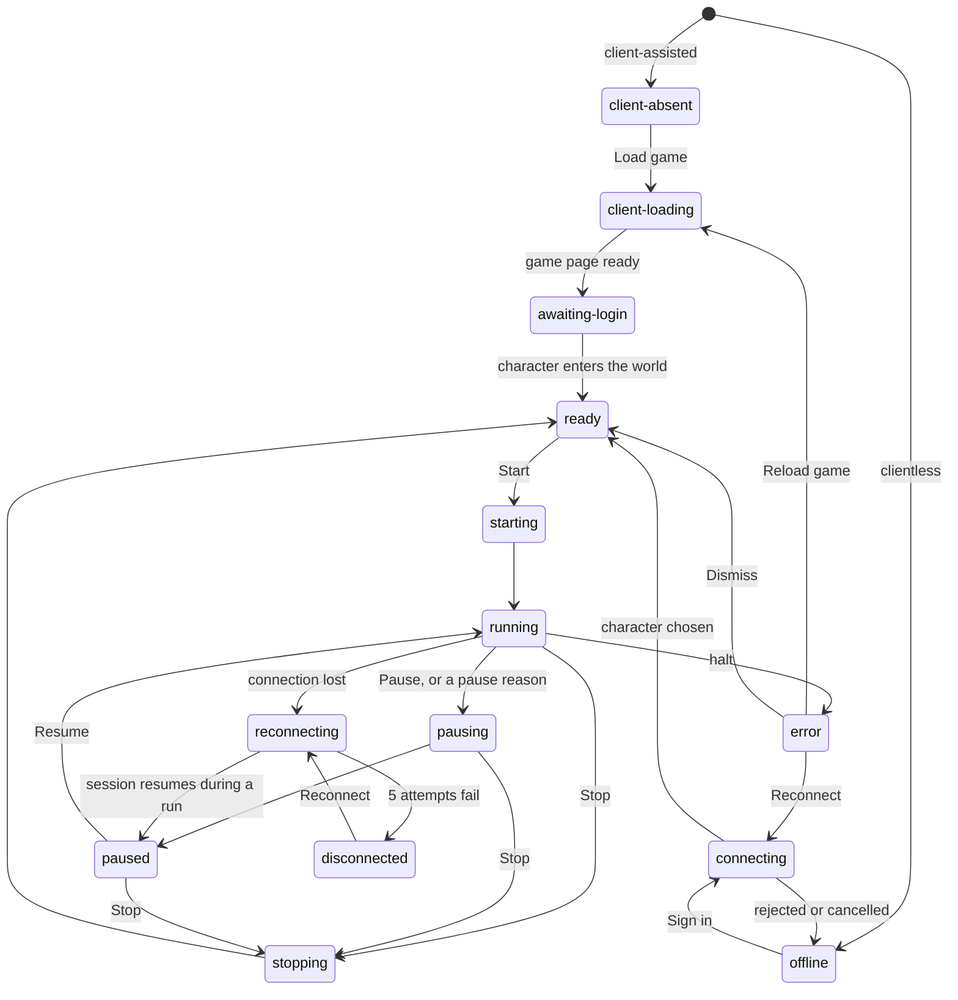

# macOS app UI prototype

This directory holds a throwaway prototype for [issue #9, Design the macOS app UI for both operating modes](https://github.com/oDestroyeRo/opentrickster/issues/9). The decisions it settled are recorded in [`DESIGN.md` on `main`](https://github.com/oDestroyeRo/opentrickster/blob/main/DESIGN.md), which is the design reference for implementation. The prototype answers one question. What layout, states, and controls should OpenTrickster use in client-assisted mode, where the game runs inside the app window, and in clientless mode, where a dashboard takes the place of the game?

The planned app uses Rust and GPUI. The prototype is a single HTML file, so a design change takes minutes. No production code depends on it, and it never merges into `main`. Every character, map, monster, item, and number in it is sample data.

## Open the prototype

1. Open `index.html` in Chrome or Safari. The page loads Preact, htm, and the IBM Plex fonts from public CDNs, so it needs a network connection.
2. To compare layouts, click the arrows beside the variant name in the bar at the bottom of the page. The Left Arrow and Right Arrow keys do the same.
3. To trigger an event, click **Simulate** in the same bar. To follow a story, choose a guided scenario, then click the step button once per step.

A URL can open any state. For example, `index.html?variant=B&mode=clientless&state=paused-potions&theme=light` opens layout B in clientless mode, paused because the HP potions ran out.

| Parameter | Values | Default |
| --- | --- | --- |
| `variant` | `A`, `B`, or `C` | `A` |
| `mode` | `client` or `clientless` | `client` |
| `activity` | `combat` or `digging` | `combat` |
| `state` | `absent`, `loading`, `login`, `connect`, `auth-failed`, `connecting`, `ready`, `ready-blocked`, `ready-after-run`, `running`, `pausing`, `paused`, `paused-potions`, `paused-weight`, `paused-fainted`, `paused-uncertain`, `paused-reconnected`, `paused-drill`, `paused-depth`, `paused-goal`, `reconnecting`, `disconnected`, `error-build`, `error-client`, `error-rejected`, or `switch-sheet` | `running` |
| `theme` | `dark` or `light` | The system appearance, which the page follows until you pick a theme |
| `tab` | `run`, `setup`, or `log` | `run` |
| `rail` | `0` hides the layout A side panel | shown |
| `drawer` | `0` hides the layout C drawer | shown |
| `notes` | `1` shows the open-question notes | hidden |
| `freeze` | `1` stops the timers for screenshots | off |
| `chrome` | `0` hides the prototype bar | shown |

## What the research already decides

The design takes these constraints from finished research and does not reopen them.

- The game runs in a native `WKWebView` child inside one GPUI window, in a reserved rectangle. A separate browser window does not meet the product requirement. Source: the [GPUI embedding report from #4](https://github.com/oDestroyeRo/opentrickster/blob/89d5993882982e959fc078f6690c8562abd7cb44/docs/research/macos-gpui-embedding.md), which calls this an architectural inference that #11 must still prove.
- The native child sits outside GPUI clipping and paint order. No GPUI-drawn tooltip, banner, message, or focus ring may cover the game rectangle. Whether macOS menus and dialogs draw over it is unverified, and #11 owns that test.
- The game page sizes its own canvas. Its desktop default is 1280 × 720 CSS pixels, scaled down to fit the rectangle it gets (#4). The prototype keeps the game rectangle at 16:9.
- The webview receives keyboard input while it has focus. Command shortcuts and Escape need joint verification with GPUI (#4).
- Nobody knows yet whether the game is readable at a given minimum size (#4). The prototype proposes 960 × 540.
- The game's version endpoint reported deployment build `f5e972fa`, according to the [target interfaces report from #3](https://github.com/oDestroyeRo/opentrickster/blob/6d996ef87a75bd8857ee998ddf30dcd99b80c1bf/docs/research/target-game-interfaces.md). The prototype treats that build as supported. Build `7c21e0b4` is invented to show the "game updated" error.
- Clientless sign-in is unproven. Client metadata names a LoginServer ticket, a GameServer handoff, and a second-password hint, but the #3 report calls these leads, not verified steps.

Combat behavior (#6), digging behavior (#7), and the session contracts (#8) are still open. Every combat and digging rule, threshold, and game message in the prototype is a proposal or sample data.

## Three layouts

The prototype builds three layouts behind one switcher. They share the same components, states, and shortcuts. Only the arrangement differs.

- **A, side rail.** The game sits on the left, with a strip under it for the last minute of activity and the recent log. A 344 px rail on the right holds the status, the run controls, alerts, and the Run, Setup, and Log tabs. **Hide panel** (⌘\\) hides the rail and the strip. The toolbar then holds the status, small HP, MP, and weight meters, and the labeled run controls, and a ticker at the bottom shows the latest result or the current alert.
- **B, bottom dock.** The toolbar holds the status and the run controls. A 280 px dock under the game shows the activity, vitals, run totals, and log in four columns.
- **C, focus HUD.** The toolbar holds the status, small HP, MP, and weight meters, and icon-only run controls. A 360 px drawer on the right holds the details, and ⌘\\ hides it. A one-line ticker at the bottom shows the latest result or the current alert.

In clientless mode, a dashboard board replaces the game in each layout. The status, the controls, and the tabs stay where they were.

These measurements come from the prototype in headless Chrome. Each window size includes the 52 px toolbar. `measure.mjs` prints this table, so a layout change can be measured again.

| Layout | Game in a 1560 × 960 window | Black bars in the game pane | Game in a 1252 × 772 window | Smallest window for a 960 × 540 game |
| --- | --- | --- | --- | --- |
| A, side rail | 1204 × 677 | 3% | 896 × 504 | 1316 × 757 |
| A, panel hidden | 1527 × 859 | 3% | 1193 × 671 | 972 × 641 |
| B, bottom dock | 1090 × 613 | 31% | 756 × 425 | 972 × 887 |
| C, drawer open | 1188 × 668 | 24% | 880 × 495 | 1332 × 641 |
| C, drawer closed | 1527 × 859 | 3% | 1193 × 671 | 972 × 641 |

The 3% for A and for C with the drawer closed is the 3 px padding around the game, not letterboxing.

With the panel hidden, the toolbar needs 1231 px in its widest state, "Paused, Check after reconnect". Below a 1232 px window, the HP, MP, and weight meters hide. `shoot.mjs` checks both views in a 1252 × 772 window and in a 972 × 641 window, the smallest that keeps a 960 × 540 game with the panel hidden.

## Decision

On 2026-11-08 the owner chose layout A with a panel-hidden view, the recommendation below. The prototype now builds that view into A.

A wastes the fewest pixels. A 16:9 game rarely fills the space a layout leaves for it, so every layout has to put the leftover somewhere. A puts the leftover height into the strip under the game, which grows and shrinks to fit. B stacks a fixed dock under the game, so the game runs out of height first and the unused width turns into black bars, 31% of the game pane in a 1560 × 960 window. C with the drawer open has nothing under the game, so the unused height turns into black bars, 24% of its game pane.

A also keeps the status, the run controls, and the reason for a pause in one column. That column stays in the same place in both modes. In clientless mode, only the left pane changes, from the game to the board. A's Setup tab gives each field the full rail width, while B's setup has to scroll inside the 280 px dock.

A has one cost. With the panel shown, it needs a window at least 1316 px wide to keep the game at the proposed 960 × 540 minimum, and in a 1252 × 772 window its game shrinks to 896 × 504. Hiding the panel removes that cost.

C was the best game-first view of the three. With the drawer closed, its game is 1527 × 859 in a 1560 × 960 window, and in a 1252 × 772 window it was the only layout that kept the game above 960 × 540. In exchange, it uses icon-only run controls and fits alerts into a 34 px ticker. Icon-only controls depend on tooltips, and a GPUI tooltip under the toolbar would open over the game. A's panel-hidden view matches C's game size and reuses its ticker but keeps labeled run controls, so it needs no tooltip over the game. That view is also a candidate answer for in-game fullscreen requests, which #4 leaves to a decision ticket.

B suits a tall window best. It needs a window at least 887 px tall for the minimum game, more than either other layout.

## Session states

One reducer drives every screen. `reduceSession` in `index.html` applies events through the transition table `T`. It touches no UI code, so the #8 contract work can lift it as is. The diagram shows the main transitions. The table `T` has the rest.



| Phase | Status pill | What the user can do |
| --- | --- | --- |
| `client-absent` | Game not loaded | Load the game from the game pane. |
| `client-loading` | Loading game, with a percentage | Wait. |
| `awaiting-login` | Log in to the game | Log in inside the game. The app never sees the password. |
| `offline` | Not connected | Sign in on the connect panel. A rejected sign-in shows its alert inside the form. |
| `connecting` | Connecting, with the current step | Choose a world and a character, or cancel. |
| `ready` | Ready | Start (⌘R) once the preflight checks pass. |
| `starting` | Starting | Stop (⌘.). |
| `running` | Running, with the activity | Pause (⌘P) or Stop (⌘.). |
| `pausing` | Pausing, Finishing this action | Stop (⌘.). The current action finishes first. |
| `paused` | Paused, with the reason | Resume (⌘R) once nothing blocks it, or Stop (⌘.). |
| `stopping` | Stopping, Finishing this action | Wait. The current action finishes first. |
| `reconnecting` | Reconnecting, attempt N of 5 | End the run (⌘.). |
| `disconnected` | Disconnected | Reconnect, or end the run (⌘.). |
| `error` | The halt's short name | The halt's recovery action. |

Every pause has a reason, and the alert names what unlocks Resume.

| Reason | Status detail | What lets the run resume |
| --- | --- | --- |
| `user` | By you | Resume. |
| `hp-potions` | Out of HP potions | Restock in the game. Resume stays locked while the bag has no HP potions. |
| `weight` | Bag weight limit | Free space in the game. |
| `drill` | Drill durability | Repair or replace the drill in the game. |
| `depth` | Drill too shallow | Equip a deeper drill or choose another area. |
| `goal` | Goal reached | Turn in the quest in the game, then resume or stop. |
| `fainted` | Character fainted | Revive in the game. |
| `no-drops` | No drops | Check the loot list and the map. |
| `uncertain` | State uncertain | Resume when the state is live again. |
| `reconnected` | Check after reconnect | Check the character, then resume. |

A halt stops the run. Some halts also stop the bot from reading game state, and the status line then says "No live state".

| Halt | Status pill | Recovery | Game state still read |
| --- | --- | --- | --- |
| `build-changed` | Game updated | Reload game, or Reconnect in clientless mode | No |
| `client-failed` | Game client stopped | Reload game, shown in the game pane | No |
| `session-replaced` | Signed in elsewhere | Log in again, or Reconnect in clientless mode | No |
| `actions-rejected` | Actions rejected | Dismiss | Yes |
| `map-forbidden` | Map blocks automation | Dismiss | Yes |

## Policies

These rules shape several screens. The owner confirmed all seven on 2026-11-08.

1. After a reconnect, a run comes back paused for a check. The bot resends nothing on its own.
2. Setup locks while the run is starting or running. While the run is paused, setup is editable, and the changes apply on resume. The activity choice stays locked until the run ends.
3. The mode switch works only when no run exists, including a run held during a disconnect. Once a game or a session is open, a system sheet asks before the app switches.
4. The bot never buys items, revives the character, or accepts or turns in quests.
5. Three rejected actions in a row stop the run instead of retrying.
6. When no state update arrives for 15 seconds, the run pauses.
7. Run counts include only results that the game confirmed. The run totals show how many sent actions the game confirmed.

## Visual system

`tokens.json` is the only source of design tokens. `node build-tokens.mjs` turns it into `tokens.css` for the prototype and `TOKENS.md` for GPUI, with each color as a `gpui::rgb` or `gpui::rgba` literal. The script exits with code 1 when any contrast pair falls below its WCAG minimum or any type size has a line height under 1.5 times the size. All 32 pairs pass, 16 in each theme, and all six type sizes pass.

- The theme follows the macOS appearance setting.
- Colors use graphite neutrals and one lagoon accent. The dark and light themes take their own steps from the same primitives. The game letterbox stays near black in both themes.
- Four status colors are reserved for good, warning, serious, and critical. The dataviz palette validator fails these four on its separation checks, which are written for categorical palettes. So no status relies on color alone. Each one has an icon and a label, and the pulse strip under the toolbar uses its own pattern for each state.
- The type is IBM Plex Sans with IBM Plex Sans Thai, so Thai character names and Latin labels share one design. IBM Plex Mono appears only in build identifiers and coordinates. Every line height is at least 1.5 times the font size, because Thai stacks marks above and below the baseline. Measured in Chrome with IBM Plex Sans Thai, the cluster ปู่ needs 1.46 times the size to fit inside its line box.

[COMPONENTS.md](COMPONENTS.md) specifies each component with GPUI notes. [TOKENS.md](TOKENS.md) lists every token value.

## Keyboard

| Shortcut | Action |
| --- | --- |
| ⌘R | Start, or Resume when paused |
| ⌘P | Pause |
| ⌘. | Stop, or End run while reconnecting or disconnected |
| ⌘1, ⌘2, ⌘3 | Show the first tab, the Setup tab, or the Log tab. The first tab is Run in A, Overview in B, and Details in C. In A, these keys also show a hidden panel. |
| ⌃Tab | Move keyboard focus between the game and the dashboard |
| ⌘\\ | Hide or show the layout A side panel, or the layout C drawer |
| Escape | Close the system sheet |

⌘R and ⌘. match Run and Stop in Xcode. ⌘P takes over Print, which the app does not need. In client-assisted mode, a toolbar badge says whether keys go to the game or to the dashboard. While the game owns the keyboard, a focus ring surrounds the game rectangle.

## Open questions

Each question names the issue that owns the answer.

1. Do macOS menus, sheets, alerts, and tooltips draw over the `WKWebView` child? Until #11 answers, every control above the game keeps a visible label. (#11)
2. Do ⌘R, ⌘P, ⌘., and Escape reach the app while the game has keyboard focus? Menu-bar key equivalents are the candidate fix. (#4, #11)
3. What is the smallest readable game size? The prototype proposes 960 × 540. (#4, #11)
4. What does the app do when the game requests fullscreen? (#4)
5. Can the app check before a run whether a map allows automation? The preflight list shows "Cannot be checked yet". (#6, #8)
6. Does the game acknowledge each action, so the app can tell sent actions from confirmed results? The #3 report lists acknowledgement behavior as unknown. (#8)
7. How does the app measure how old its game state is? (#8)
8. Which units and leash rules does the combat movement boundary use? (#6)
9. How does digging choose a spot, and what happens when a monster attacks during a dig? (#7)
10. Which steps does clientless sign-in need, and is a second password one of them? (#3, #8)
11. Can a reload ever clear an unsupported game build, or does only an OpenTrickster update fix it? (#8)
12. How does the app ask for notification permission before the first alert? No issue tracks this yet.

## Confirmed decisions

The owner confirmed decisions 1 to 7 on #9 on 2026-11-08.

1. Layout A, with a panel-hidden view where ⌘\\ hides the side panel.
2. The theme follows the macOS appearance setting.
3. Graphite neutrals with a lagoon accent.
4. IBM Plex Sans with IBM Plex Sans Thai.
5. The shortcuts in the keyboard table.
6. The seven policies above.
7. The alerts. The app notifies on a pause with a reason, a lost connection, and a reached goal, and it badges the Dock icon. All four are on by default.
8. The UI language had no recommendation. The default is English for the app's own text, with game data such as Thai names shown as the game supplies it. Thai or both stays open for the owner.

## Verify the prototype

`shoot.mjs` drives the prototype in headless Chrome with a dark system appearance. It saves 38 screenshots to `screenshots/` and runs 538 checks. It exits with code 1 when any check fails.

1. Install `playwright-core` outside the repository.

   ```sh
   npm install --prefix /tmp/pw playwright-core
   ```

2. Run the checks. They need Google Chrome.

   ```sh
   PLAYWRIGHT_CORE=/tmp/pw/node_modules/playwright-core/index.mjs node shoot.mjs
   ```

3. After you edit `tokens.json`, run `node build-tokens.mjs`, then run the checks again.
4. After a layout change, run `measure.mjs` with the same `PLAYWRIGHT_CORE` setting and compare its table with the one in this README.

Each screenshot, and layout A in both views in a 1252 × 772 and a 972 × 641 window, gets these checks:

- The game rectangle is 16:9.
- No toolbar, rail, dock, drawer, ticker, strip, footer, or tab row overflows sideways.
- No GPUI-drawn banner, tooltip, or message overlaps the game rectangle.
- No column in the dock overview needs to scroll.
- Every text line is at least 1.5 times its font size.
- State freshness shows exactly once. In layout C, it hides while the ticker holds an alert.

The interaction checks drive the keyboard run controls, a stop during pausing, the mode-switch refusals during a run and during a held disconnected run, the mode-switch sheet, the HP potions scenario, a reconnect that pauses for a check, layout switching, and game focus. They also check that a lane tooltip under the game stays outside the game rectangle, that a rejected password shows one alert inside the sign-in form, that the lanes caption matches the freshness chip during a halt, and that the refusal message in each layout stays outside the game rectangle. For the panel-hidden view, they check that ⌘\\, ⌘2, and the panel button hide and show the panel, that the run controls stay labeled, that the meters hide below a 1232 px window, that the ticker says why Start is unavailable, and that the ticker leaves Resume to the toolbar. The theme checks follow a change of system appearance in both directions and keep a theme picked in the prototype bar. A final check fails on any page error.

## Files

- `index.html` is the prototype.
- `tokens.json` holds the design tokens.
- `build-tokens.mjs` generates `tokens.css` and `TOKENS.md`, and refreshes the token tables in the repository's `DESIGN.md` when that file is present. Do not edit the generated files or tables by hand.
- `COMPONENTS.md` specifies the components for GPUI.
- `shoot.mjs` takes the screenshots and runs the checks.
- `measure.mjs` measures the game rectangle in each layout and prints the layout table.
- `screenshots/` holds the latest screenshots.
